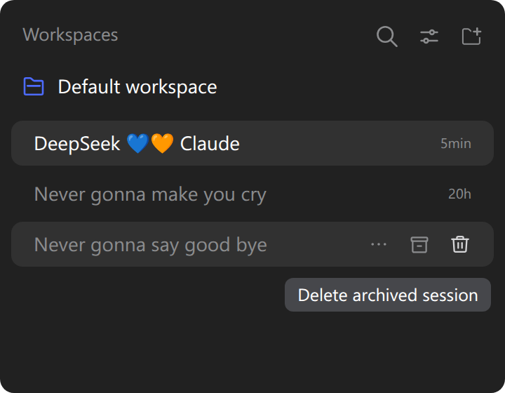
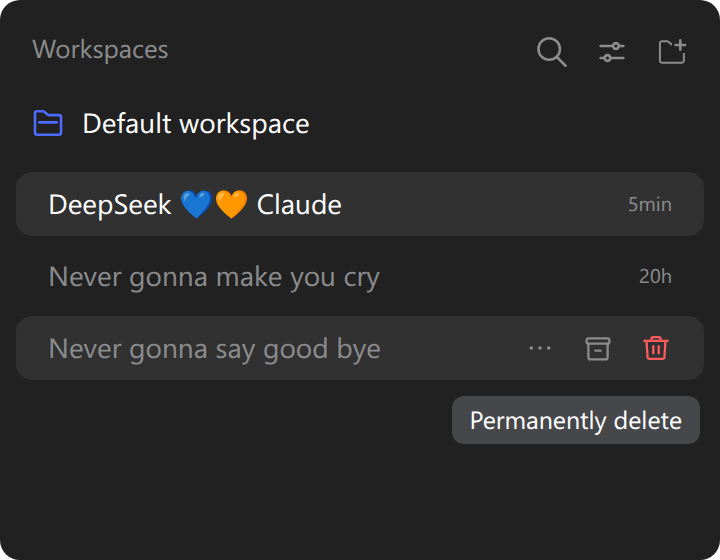

# Delete Archived Session in DSH

_**English** | [简体中文](README.zh-CN.md)_

A [DeepSeek Harness](https://github.com/deepseek-ai/deepseek-harness) (`dsh`) plugin that permanently deletes archived sessions with a two-step confirm, from the sidebar row hover strip and the "⋯" more-menu. It stops the session's running work and removes its log and projection-cache record from disk.

## Screenshots

| Hover the delete button | Armed, click again to confirm |
| --- | --- |
|  |  |

## Install

Use `--profile web` for a `dsh web` server or `--profile desktop` for the desktop app, then restart the Harness.

```bash
# npm
dsh plugin --profile web add dsh-delete-archived-session
# GitHub (latest)
dsh plugin --profile web add github:Cnily03/dsh-delete-archived-session
```

The desktop app can also install it from its built-in plugin market.

## Usage

The control renders only while the row's session is archived, in two places:

- **Hover strip** — a trash icon after the archive and pin cells.
- **"⋯" more-menu** — a "Delete archived session" row that dismisses the menu on click.

Both reuse the shipped `IconTrashOutlineRegular`, `Tooltip` and `MenuItemButton`, so they match the native controls.

Deleting takes two deliberate clicks:

- The first click **arms** the control — it turns red, the label becomes **Permanently delete**, and it stays armed for 3 seconds.
- A click while armed deletes the session. After the arm lapses, a click simply re-arms.

Deleting stops the session's running work, removes its log directory and projection-cache record from disk, and clears the workspace accounting so the row disappears.

## Archiving vs. deleting

A session must be archived before it can be deleted. Archiving alone does not stop the agent or remove any file; deletion is what stops the work and clears the files.

## Develop

```bash
pnpm install
pnpm build        # tsup -> dist/
pnpm typecheck    # tsc --noEmit
pnpm test         # node --test
pnpm format       # biome check --write
```

| Path | Purpose |
| --- | --- |
| `src/index.ts` | Host half: delete route, stop/idle/flush/remove, cleanup, startup sweep. |
| `src/client.ts` | Client half: the two-step control, arm timer and overlay notice. |
| `src/locale.ts` | Namespace, route and message dictionaries. |
| `cordis.patch.yml` | Bundle patch that inserts the Host row. |

## License

Copyright (c) Cnily03. All rights reserved.

Licensed under the [MIT License](LICENSE).
