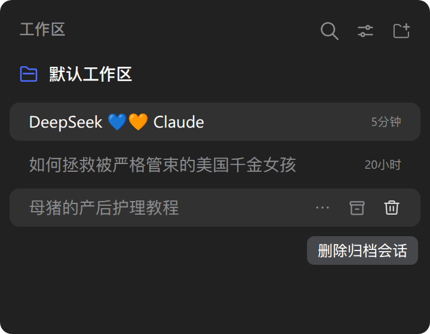

# 在 DSH 中删除归档会话

_[English](README.md) | **简体中文**_

一个 [DeepSeek Harness](https://github.com/deepseek-ai/deepseek-harness)（`dsh`）插件，用两步确认彻底删除归档会话，入口在侧栏行的悬停按钮和「⋯」更多菜单。删除会停止该会话正在进行的工作，并从磁盘移除它的日志与投影缓存记录。

## 截图

| 悬停删除按钮 | 变红后再次点击确认 |
| --- | --- |
|  |  |

## 安装

web 部署用 `--profile web`，桌面应用用 `--profile desktop`，装好后重启 Harness。

```bash
# npm
dsh plugin --profile web add dsh-delete-archived-session
# GitHub（最新）
dsh plugin --profile web add github:Cnily03/dsh-delete-archived-session
```

桌面应用也可以直接从内置插件市场安装。

## 用法

该控件仅在行对应的会话处于归档状态时出现，位于两处：

- **悬停按钮** —— 归档、置顶图标之后的一个垃圾桶图标。
- **「⋯」更多菜单** —— 一行「删除归档会话」，点击后关闭菜单。

两者都复用宿主的 `IconTrashOutlineRegular`、`Tooltip` 和 `MenuItemButton`，因此与原生控件保持一致。

删除需要两次有意的点击：

- 第一次点击**预备**该控件 —— 它变红，文案变为**彻底删除**，并保持预备态 3 秒。
- 在预备态下再点一次即删除会话。预备态超时后，点击只是重新进入预备态。

删除会停止该会话正在进行的工作，从磁盘移除它的日志目录与投影缓存记录，并清理工作区记账，使该行消失。

## 归档与删除的区别

会话必须先归档才能删除。只归档不会停止代理、也不会删除任何文件；删除才会停止工作并清除文件。

## 开发

```bash
pnpm install
pnpm build        # tsup -> dist/
pnpm typecheck    # tsc --noEmit
pnpm test         # node --test
pnpm format       # biome check --write
```

| 路径 | 用途 |
| --- | --- |
| `src/index.ts` | Host 半部分：删除路由、停止/空闲/刷盘/移除、清理、启动清扫。 |
| `src/client.ts` | Client 半部分：两步控件、预备计时器与覆盖层提示。 |
| `src/locale.ts` | 命名空间、路由与消息词典。 |
| `cordis.patch.yml` | 插入 Host 行的 bundle 补丁。 |

## License

Copyright (c) Cnily03. All rights reserved.

Licensed under the [MIT License](LICENSE).
